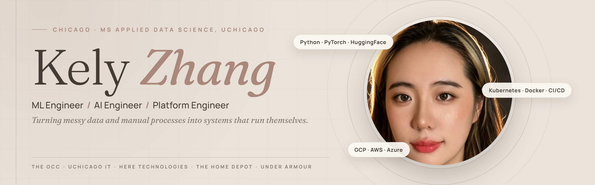

<h3 align="center"><i>ML · AI · Platform Engineering — UChicago MS Applied Data Science ’26</i></h3>

  
  
  
  

---

Hi, I’m **Kely (Yichun) Zhang**. I build the systems around models as much as the models themselves: the pipeline that feeds them, the automation that replaces a manual queue, and the dashboard that tells leadership something is off before production does.

Right now I’m a **Platform Engineering intern at The OCC** (Options Clearing Corporation), writing tools that sit between Jira, Artifactory, Kubernetes and the PR workflow. I’m also an **ML engineer on a HERE Technologies–sponsored capstone**, estimating real-world object dimensions from street-level imagery. Before that I built chatbots for **UChicago IT Services**, NL-to-SQL for **The Home Depot**, and forecasting and sentiment work for **Under Armour**.

**Statistics + Economics at the University of Toronto** (High Distinction, Dean’s List all four years), now finishing an **MS in Applied Data Science at the University of Chicago** in December 2026.

 

---

## What I’ve shipped

**A manual artifact-publishing process, now rule-based** · *The OCC*. A Python tool that reads incoming Jira requests, checks them against a whitelist, and publishes approved artifacts to Artifactory through its API. The whitelist is the safety net: bad or misrouted uploads stop there.

**End-of-Life libraries, flagged at PR time** · *The OCC*. A script that joins data across internal systems to find EoL dependency usage, then hooks into the PR workflow to alert the team that owns it. Long-standing tech debt, handled in code.

**Kubernetes config drift, visible across clusters** · *The OCC*. A live dashboard that diffs ConfigMaps across the West, East and RTOP clusters so production discrepancies reach engineering leadership. The prevention mechanisms I proposed were adopted to cut recurring deployment errors.

**Metric 3D from a dashcam’s point of view** · *HERE Technologies capstone*. Chicago street-view imagery collected through the Mapillary API, with MapAnything, DepthAnything and VGGT evaluated for depth and 3D reconstruction. Dimension estimates are checked against ground truth for accuracy and real-world feasibility.

**A chatbot that knows the account string** · *UChicago IT Services*. An Oracle Digital Assistant for the Purchase Requisition workflow, with a custom account-validation API, conversation flows and agent teams. Also on the Neo4j course-advisor AI: frontend, stakeholder demos, and Dockerizing it off the VM.

**Ask the data instead of opening the dashboard** · *The Home Depot*. An NL-to-SQL chatbot on BigQuery, plus a repaired Jotform → Apps Script → BigQuery → Power BI pipeline that keeps product-engineering dashboards up to date.

---

## How I work

| As an ML / AI engineer | As a platform engineer |
| --- | --- |
| Pick the model that holds up against ground truth, not the one with the best demo | Replace manual queues with rule-based automation that has a fail-safe |
| Fine-tune and evaluate: DistilBERT, BERTopic, ViT / ResNet, SqueezeNet, depth models | Wire tools into the APIs teams already use: Jira, Artifactory, GitHub PRs |
| Ship it where people can use it: ONNX in the browser, Streamlit / web dashboards | Make drift visible: Kubernetes config diffs across clusters |
| RAG, agents and NL-to-SQL on real enterprise data | Docker, CI/CD, GitHub Actions, Jenkins, IaC |

---

## Stack

**Languages**

**ML & AI**

**Cloud, Platform & DevOps**

**Data & BI**

---

## Selected projects

| Project | What it is |
| --- | --- |
| [**ai-news-sentiment-pipeline**](https://github.com/Yichun-Zhang-ZYC/ai-news-sentiment-pipeline) | BERTopic + NER + fine-tuned DistilBERT tracking how news media covers AI’s impact on business and industry, with an interactive sentiment and topic dashboard. |
| [**plant-disease-classifier**](https://github.com/Yichun-Zhang-ZYC/plant-disease-classifier) | SqueezeNet 1.1 fine-tuned on PlantVillage (98.13% test accuracy). A drag-and-drop leaf classifier that runs entirely client-side with ONNX Runtime Web. |
| [**Street-level dimension estimation**](https://github.com/Yichun-Zhang-ZYC/Real-World-Dimension-and-Metric-Estimation-of-Physical-Features-from-Street-Level-Imagery-) | HERE capstone: real-world metric estimation of physical features from Mapillary imagery and 3D reconstruction. |
| [**chatbot_db11**](https://github.com/Yichun-Zhang-ZYC/chatbot_db11) | Natural language → SQL query chatbot. |
| [**course_advisor_simple_version**](https://github.com/Yichun-Zhang-ZYC/course_advisor_simple_version) | AI course advisor for UChicago students. |
| [**room-to-grow**](https://github.com/Yichun-Zhang-ZYC/room-to-grow) | An open-source, web-first personal growth app: completing real-life tasks builds a room you actually care about. |
| [**MLOps-final**](https://github.com/Yichun-Zhang-ZYC/MLOps-final) · [**data-science-blog-with-devops**](https://github.com/Yichun-Zhang-ZYC/data-science-blog-with-devops) | MLOps and DevOps coursework: CI/CD, containers, deployment. |

---

## Experience

| | Role | When |
| --- | --- | --- |
| **The OCC** | Software (Platform) Engineering Intern, Tools Automation | Jun 2026 – present |
| **HERE Technologies** | Machine Learning Engineer, sponsored capstone | Mar 2026 – present |
| **UChicago IT Services** | AI Developer | Nov 2025 – Jun 2026 |
| **The Home Depot** | AI & Data Engineer Intern, Shanghai | Jul – Sep 2025 |
| **Under Armour** | Data Scientist Intern, Shanghai | Mar – May 2025 |

## Education

**MS, Applied Data Science, University of Chicago** · 2025 – Dec 2026 
Big Data & Cloud Engineering · Next-Gen NLP · MLOps · Time Series Analysis · Machine Learning

**BS, Statistics (Major), Economics with Data Analytics Focus (Major), Math (Minor), University of Toronto** · 2019 – 2023 
High Distinction · Dean’s List, 4 consecutive years · Excellent Academic Performance Scholarship, 3 years

---

<i>Statistics taught me to doubt the number. Engineering taught me to automate the doubt.</i> 
Let’s talk: <a href="https://www.linkedin.com/in/yichun-zhang-zyc/">LinkedIn</a> · <a href="https://kelyzhang.com">kelyzhang.com</a>

